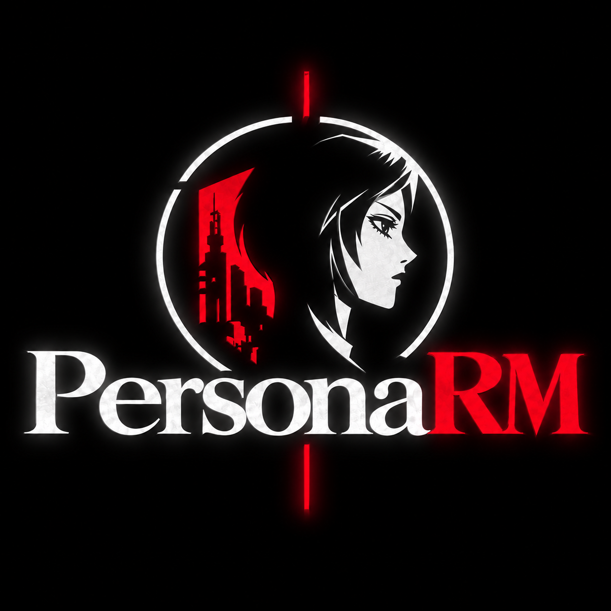

<div align="center">



# PersonaRM

**A native PC runtime and launcher for *Persona 2: Eternal Punishment* (PlayStation 1)**

[](./LICENSE)
[](#building-from-source)
[](#building-from-source)
[](https://github.com/sargon494/PersonaRM/actions)
[](https://sargon494.github.io/PersonaRM/)

[Website](https://sargon494.github.io/PersonaRM/) · [Status](#status) · [Roadmap](#roadmap) · [Quick start](#quick-start) · [Building](#building-from-source) · [Documentation](#documentation) · [Contributing](#contributing)

</div>

---

## Overview

PersonaRM aims to run *Persona 2: Eternal Punishment* natively on Windows and Linux, without an external emulator. It rebuilds the PlayStation 1 hardware the game depends on (MIPS R3000A CPU, GTE, GPU, MDEC, SPU, CD-ROM) and wraps it in a launcher that manages your disc images, controls, and display options.

> **Not fully playable yet.** PersonaRM is a research-driven work in progress, and the first public builds are on [GitHub Releases](https://github.com/sargon494/PersonaRM/releases) (v0.2.0 is the latest). The game's real executable plays its intro videos with sound, shows the title screen and, on a new game, reaches the first story scenes, free movement of the player character and the main menu. An optional SDL3 window shows it live, with music and sound effects from the emulated SPU. See [Status](#status) for what exists today.
>
> **Current phase: native port delivered (v0.2.0).** v0.2.0 is the first release with native code: on first PLAY the launcher prepares recompiled code from your own disc on your PC (TinyCC is bundled; about 10-15 s the first time, then cached), and the game runs it natively, about 2x faster than the interpreter, with byte-identical RAM over 19,000 frames on JP disc 1. If preparation fails, the game runs in the interpreter. Windows only for now. Next: widescreen polish, and more of the story played and checked from user reports. Play, and press F5 at any glitch and report it. The first public releases are out (see [Quick start](#quick-start)). Steps 1 and 2 are done. Step 3, first boot, continues for playing further: on JP disc 1, the first battle is reached and won from a save at the school, with no emulator bugs on that path, and several battles played by hand showed no glitches. The lightweight launcher (Rust + egui) is out: it starts the game with these settings and updates itself from GitHub Releases. The boot matches the PCSX-Redux reference emulator at event level up to the first overlay loads (gate G1: pass with known BIOS and timing differences). Music and sound effects now play, with the SPU on emulated time. The recompiler now also covers overlays: each is validated by a hash of its code in RAM and falls back to the interpreter if that code is overwritten. On disc 1, with the recompiled main executable and overlays, essentially 100% of instructions run as native code, and the trace still matches the interpreter exactly (to free movement, about 19,700 frames). Device timing now advances lazily, with exact results: on a fast PC (headless Release build) the interpreter went from about 74 to 129 fps, and the recompiled mode from about 100 to 370 fps. Memory cards work: standard 128 KB `.mcd` files via `--memcard1 <path>` / `--memcard2 <path>` (created and formatted if missing). On disc 1 the game saves from the main menu, and after a reboot CONTINUE loads the save. The SDL3 window can run the recompiled mode (`--recomp`) with memory cards, so a play session with saves is possible on a capable PC (a developer build; see [Quick start](#quick-start)). Mods: a first version of texture dump and replacement is in the SDL3 window (`--texture-dump` and `--mods`; see the mods row in the status table). The game's text system has been located: dialogue uses the game's own 16-bit character codes in event banks, drawn with a 12x12 font, and text speed is a single setting in the main executable. The faster-text option is in: `personarm_sdl --text-speed normal|fast|instant` (or `gameplay.text_speed` in a mod manifest). It is built on a small, game-agnostic gameplay-patch layer: patches are applied when the game writes a given memory word, guarded by the expected bytes. The first dialogue line takes 138 frames to appear at normal, 48 at fast and 6 at instant. Disc 1 only for now. Disc 2, the Sumaru TV Special Preview Disc, now boots and runs: it is a promotional TV-channel disc with ATLUS and channel videos and a newspaper TV listing, and each programme is a short in-engine scene with dialogue (a weather report, a variety show, Igor in the Velvet Room). Its interpreter and recompiled modes match exactly, with about 99.99% of instructions running as native code. The US release (SLUS-01158) boots to free movement and the main menu with English text, and its recompiled mode matches the interpreter. The JP release is still the primary target; the future launcher will let you pick English by booting the US disc. A settings file (`settings.json`, see [docs/SETTINGS.md](docs/SETTINGS.md)) covers window mode and scale, integer scaling, aspect, vsync, fps target, internal resolution, volume and mute, key and pad remapping, save folder, per-game options and pause on focus loss; command-line flags override it. Internal resolution (`--resolution-scale 1-4`) runs 2x in real time on the software rasterizer; the GPU renderer (`--renderer gpu`) runs 1 to 9x and also works with frame interpolation. The `p2text` tool extracts and reinserts field dialogue ([docs/TRANSLATION_TOOLS.md](docs/TRANSLATION_TOOLS.md)); it round-trips all of disc 1 with 0 failures. With file mods ([docs/MOD_FILES.md](docs/MOD_FILES.md)), edited dialogue now shows in the running game, verified on the shrine scene. Translations ship only as patches, never as game text. Recent additions: the menu cursor and UI labels on JP disc 1 are visible again (a GPU reset no longer wipes video memory); the gamepad's left stick drives the d-pad, and button presses are logged; `--record-input` records a play session as a replayable input script (the replay is byte-identical from the same starting state); widescreen (`--widescreen 16:9` or `21:9`) is experimental; the GPU renderer (`--renderer gpu`) runs at up to 9x (4K) or auto; save states (F5 / F8) and hold-to-fast-forward are in; `p2text` warns when a translated line overflows the 288 px dialogue window. 
PersonaRM follows a strict **Bring Your Own Copy (BYOC)** model:

- **No game content is distributed.** The repository contains no game binaries, ROMs, or assets.
- **You supply your own disc.** Provide an image (`.cue`/`.bin`, `.iso`, or `.img`) from a copy you own.
- **Quality of life.** Save states (F5 save, F8 load, ten slots) and hold-to-fast-forward up to 16× are in the window build ([settings](docs/SETTINGS.md#save-states-and-fast-forward)).
- **Planned enhancements.** Widescreen is experimental (`--widescreen 16:9` or `21:9`). Controller glyphs for PlayStation, Xbox, and Nintendo layouts are planned.

New to the codebase? Start with the [Developer Guide](docs/DEVELOPER_GUIDE.md) and the [Architecture overview](ARCHITECTURE.md).

## What we know about the game

Verified by reading the Japanese release's discs and executable (nothing here is copied from the game):

- The main game is one disc. The Japanese *Deluxe Pack* adds a separate **Sumaru TV Special Preview Disc**, which boots on its own with its own executable and is not a second story disc.
- Both discs use the standard `PS-X EXE` format and share one engine, built with the Sony PsyQ libraries.
- Game data lives in numbered `F*.BIN` / `F*.EXT` containers indexed by a position table on the disc. Many containers are RLE-compressed. Videos are 320×240 STR streams with XA audio.
- The game calls both BIOS routines and PlayStation hardware registers directly, so a faithful runtime needs both a BIOS layer and real hardware behaviour.
- Large parts of the game code are **overlays**: raw MIPS code loaded from the disc into fixed memory slots on demand. This shapes the design below.

## Roadmap

The chosen approach is an **interpreter-first native runtime**, with static recompilation added on top once the interpreter can be checked against a reference emulator:

1. ✅ **CPU correctness.** A conformance test suite for every MIPS-I instruction, including delay slots, load delays, unaligned access, overflow traps, exceptions, and edge cases of `DIV`.
2. ✅ **Complete machine core.** Interrupt controller, DMA, timers, CD-ROM, joypad bus, and a real GPU rasterizer.
3. 🔨 **First boot.** Run disc 1 from the intro FMVs to player control (done) and match a reference emulator trace (done, gate G1); keep playing further.
4. ✅ **Static recompilation.** Translate the main executable and each overlay ahead of time, with the interpreter as fallback. Delivered in v0.2.0: the launcher prepares native code from your disc on first PLAY (TinyCC, cached). Started: `tools/recomp_gen` translates MIPS functions to C++ with the interpreter's exact semantics; the synthetic differential gate G2 shows 0 divergences, and locally all 399 functions found in the disc 1 main executable matched the interpreter on random inputs. Overlays are now covered too, each checked by a hash of its code in RAM. Memory cards and saves work, and the window can run the recompiled code.
5. **Replace library routines** (video playback, pad, memory card, CD, SPU, GPU) with hand-written native code.
6. **Host layer.** SDL3 window and input, OpenGL display, host audio, then the launcher and modern enhancements.

A JIT is not planned: the PS1 workload does not call for one.

**Future games** (planned, no dates, nothing playable yet): the launcher is meant to host more Atlus games. Next on the wish list: Digital Devil Saga 1 & 2 (PlayStation 2) and Shin Megami Tensei IV and Shin Megami Tensei IV: Apocalypse (Nintendo 3DS). Each needs its own new console core, so these are long-term.

## Status

| Subsystem | Status |
|---|---|
| Disc reading (ISO 9660 and raw 2352-byte images, `.cue` resolution) | ✅ Implemented |
| `PS-X EXE` loader | ✅ Implemented (ELF is not supported) |
| MIPS-I CPU interpreter | ✅ Instructions, delay slots, exceptions and interrupts pass a 199-check conformance suite |
| Static analysis tools (`psx_analyze`: FILEPOS, file extraction, chunks, RLE, hazard scan, control-flow graph) | ✅ Implemented |
| GTE (geometry engine) | ✅ All 22 commands, FLAG and UNR division (not yet checked against real-hardware results) |
| GPU and VRAM | ✅ Software rasterizer: polygons, lines, sprites, textures with CLUT, semi-transparency, GPUREAD |
| MDEC video and XA audio | ✅ Wired in; the game's FMVs decode with sound (timing values approximated) |
| SPU audio | 🟡 Registers, ADPCM, pitch, ADSR and reverb on emulated time (44,100 Hz); CD/XA audio mixed in; music and sound effects play. The Gaussian interpolation table is still an approximation |
| BIOS HLE | ✅ Kernel events, interrupt chain, patchable tables and file calls the game uses and memory card calls |
| Interrupts, VBlank, root counters | ✅ Implemented (timing approximated) |
| DMA, CD-ROM | ✅ Wired into the bus; the game reads FILEPOS and its first overlay through them (timing approximated) |
| Real-game boot (`personarm --boot`) | 🔨 Disc 1: intro, title, new game, story scenes, free movement and the main menu (scripted input via `--input-script`); the menu cursor and UI labels on JP disc 1 are visible again (a GPU reset no longer wipes video memory); a first battle reached and won from a school save, with no emulator bugs on that path; disc 2 (Sumaru TV Special Preview Disc) boots and runs |
| Reference comparison (gate G1) | ✅ Matches PCSX-Redux at event level up to the first overlay loads; known BIOS/timing differences |
| Trace format for reference comparison (`PRMTRACE v1`) | ✅ Format, comparator and `--trace-out` |
| Static recompiler (`tools/recomp_gen`) and native code | ✅ v0.2.0: the launcher prepares native code from your own disc on first PLAY (`personarm_native`, TinyCC bundled, about 10-15 s, cached); overlays covered (code-hash checked, interpreter fallback); on JP disc 1 the native and interpreter RAM match over 19,000 frames, about 2x faster. Settings toggle "Native code (recompiled)". Windows only for now. See [docs/NATIVE_CODE.md](docs/NATIVE_CODE.md) |
| Memory cards / saves | ✅ Standard 128 KB `.mcd` cards via `--memcard1/2`; disc 1 saves and CONTINUE loads work |
| Mods: texture dump and replacement (`--texture-dump`, `--mods`) | 🟡 First version; texture mods are SDL3 window only, off by default. `--texture-dump <dir>` saves each texture uploaded to video memory as PNG (once per content hash); `--mods <dir>` draws replacement PNGs from `mods/<name>/textures/` (optional `manifest.json` priority). Output stays at native resolution; palette variants share one PNG; textures uploaded in pieces give one PNG per piece. Mods must contain only the modder's own images, never original game files. File mods (`files/Fnnnn.BIN`): a mod can replace a whole disc file, and the running game loads it instead of the disc copy; the file may grow. Works with `--mods` in `personarm --boot` and `personarm_sdl`, on JP disc 1 and the US release, in interpreter and recompiled modes. With no mods active, output is byte-identical. See [docs/MOD_FILES.md](docs/MOD_FILES.md) |
| Text speed option | 🟡 Disc 1 only. `--text-speed` takes `normal`, `fast` or `instant` (or `gameplay.text_speed` in a mod manifest). Built on a small, game-agnostic gameplay-patch layer. The first dialogue line takes 138 frames to appear at normal, 48 at fast and 6 at instant |
| Window, input and audio (`personarm_sdl`, optional SDL3) | 🟡 Window, keyboard/gamepad and audio work (the gamepad's left stick drives the d-pad, and button presses are logged); the full SPU and CD/XA mix plays in the window and in `--dump-audio` output, and runs with `--recomp` and `--memcard1/2`. Frame rate target (`--interp 30|60|90|120`, or `video.fps_target`): 30 presents every other frame, 60 is native (default), 90 and 120 are display-only frame interpolation that synthesizes frames from the GPU primitives; since v0.2.0 only 3D scenery is interpolated (characters, portraits and text are drawn as in the real frame, so no texture jitter); known limits: edge popping, no perspective correction, one game frame of extra latency |
| US release (SLUS-01158) | 🟡 Boots to free movement and the main menu with English text; recompiled mode matches the interpreter. The JP release remains the primary target |
| Settings file (`settings.json`) | 🟡 In the per-user config folder, or given with `--settings <file>`; command-line flags override it. `fps_target` 30, 60, 90 and 120 all work; `language` is stored only. See [docs/SETTINGS.md](docs/SETTINGS.md) |
| Internal resolution (`--resolution-scale`) | 🟡 `1`-`4` on the software renderer, `1`-`9` or `auto` on the GPU renderer, or `video.resolution_scale` in the settings file. Stray lines and tile seams at high internal resolution are fixed (v0.2.0). 2x runs in real time on the software rasterizer; the GPU renderer (`--renderer gpu`, see below) also works with frame interpolation |
| Translation tools (`p2text`) | 🟡 Extracts and reinserts field dialogue; round-trips all of disc 1 with 0 failures. With file mods, edited dialogue shows in the running game (JP disc 1, verified on the shrine scene). Translations ship only as patches. `p2text` warns when a translated line overflows the 288 px dialogue window; US glyph widths are read from the user's disc. See [docs/TRANSLATION_TOOLS.md](docs/TRANSLATION_TOOLS.md) |
| Launcher (`PersonaRM.exe`, Rust + egui) | ✅ Settings for language (JP or US disc), frame rate 30/60/90/120, renderer, internal resolution, widescreen, window mode, volume, text speed, save folder, pause when unfocused, the "Native code (recompiled)" switch and per-game gameplay options (encounter rate, skip movies, battle speed, text speed; also F1-F4 in game). Starts the game with no console window and hides while you play. Auto-update from GitHub Releases: SHA-256 checked, never touches settings, saves or memory cards. "Find my discs" finds and identifies your Persona 2 discs (JP, US, the disc 2 promo) and fills the fields; it checks the dump is complete. Active gameplay options (F1-F4) and fast-forward show as small on-screen badges, with a short message when you change one; "Show status icons" turns them off. Older installs with `launcher.exe` keep updating and move to the new name automatically. See [docs/LAUNCHER.md](docs/LAUNCHER.md) |
| Releases | ✅ v0.1.0, v0.1.1, v0.1.2 and v0.2.0 (latest) on [GitHub Releases](https://github.com/sargon494/PersonaRM/releases): a Windows x64 zip with `PersonaRM.exe`, `personarm_sdl.exe`, `personarm_native.exe`, `libtcc.dll`, `SDL3.dll`, `personarm.exe`, README, LICENSE and docs. No game data, BIOS or game code; you need your own disc image |
| GPU renderer (`--renderer gpu`) | 🟡 On SDL_gpu (D3D12 on Windows; other platforms use the software renderer). Presents directly with no readback: about 8 ms per frame at 4x and about 11 ms at 9x (4K), against about 37 ms in software at 4x. Lines and the mask run on the GPU; works with widescreen and frame interpolation. Scale 1-9 or `auto`. Fixed: portraits and text no longer jitter in menus (most visible at 120 fps). Some features still fall back to the software renderer or are missing. See [docs/GPU_RENDERER.md](docs/GPU_RENDERER.md) |
| Widescreen (`--widescreen`, `video.widescreen`) | 🟡 Experimental: `--widescreen 16:9` or `21:9` shows a wider 3D view. Dialogue, text and portraits over 3D keep 4:3; menus and FMV stay 4:3. Fixed: characters no longer split apart, full-screen fades, tints and shadows cover the whole wide picture, and scenes it can't handle safely fall back to 4:3 automatically. Known issues: empty room edges are visible at the sides; text can jitter. 4:3 is the recommended mode. See [docs/WIDESCREEN.md](docs/WIDESCREEN.md) |
| Save states and fast-forward | ✅ F5 save, F8 load, F6/F7 slot. Deterministic. The memory card is never touched by states. A crash when loading a state saved with widescreen on is fixed; `personarm_sdl --load-state N` loads slot N at start. States load only in the build they were made with (not across releases); memory-card saves always carry over. Hold Tab or R3 to fast-forward: up to 4x by default (`video.fast_forward_max`), 16x max. See [docs/SETTINGS.md](docs/SETTINGS.md#save-states-and-fast-forward) |
| Input recording (`--record-input`) | ✅ Records a play session as a replayable `--input-script` file; the replay is byte-identical from the same starting state. See [docs/SETTINGS.md](docs/SETTINGS.md#command-line) |

## Quick start

### Play (Windows)

1. Go to [Releases](https://github.com/sargon494/PersonaRM/releases) and download the latest `PersonaRM-vX.Y.Z-windows-x64.zip` (v0.2.0 is the latest).
2. Unzip it and run `PersonaRM.exe`.
3. Set your disc `.cue` (the Japanese and/or the English US release), or let **Find my discs** find it, and press **PLAY**.

You need your own disc image, from a copy of *Persona 2: Eternal Punishment* that you own. Each release contains no game data, BIOS or game code.

The launcher sets the language (which disc is used), frame rate (30, 60, 90 or 120), renderer (Software or GPU), internal resolution, widescreen, window mode, volume, text speed, save folder and pause when unfocused. It hides while you play and comes back when the game exits. It checks GitHub Releases for updates on start; downloads are verified with SHA-256 and updates never touch your settings, saves or memory cards.

On the first PLAY for a disc, the launcher prepares native code from your own disc on your PC (about 10-15 s, then cached). Nothing from the game is downloaded or shipped. Native code is Windows only for now; see [docs/NATIVE_CODE.md](docs/NATIVE_CODE.md).

**Requirements**

- A legally obtained copy of *Persona 2: Eternal Punishment*.
- Windows 10/11 or a modern Linux distribution.

### Developer build

**Usage**

```bash
# Find disc images in a folder
personarm --scan "/path/to/your/discs"

# Check that a disc image is recognized
personarm --verify-disc "/path/to/disc1.cue"

# Open the interactive Portal (game hub and configuration)
personarm --portal

# Show every option
personarm --help
```

The SDL3 window (`personarm_sdl`) needs a build with `-DPRM_WITH_SDL3=ON` and recompiled code generated locally from your own disc. With that build, you can play disc 1 with a memory card:

```bash
personarm_sdl "/path/to/disc1.cue" --recomp --memcard1 "/path/to/card1.mcd"
```

Settings are stored in `personarm_config.json`. The SDL3 window also reads `settings.json`; see [docs/SETTINGS.md](docs/SETTINGS.md).

## Building from source

### Prerequisites

- CMake 3.20 or newer
- Ninja, or a standard Make toolchain
- Python 3 (for integration tests)
- A C++17 compiler:
  - **Windows:** Visual Studio 2022 Build Tools (MSVC) or Clang
  - **Linux:** GCC 9 or newer, or Clang

### Windows (MSVC)

Open a *Developer PowerShell for VS 2022* and run:

```powershell
cmake -S . -B build -G Ninja -DCMAKE_BUILD_TYPE=Release
cmake --build build
```

### Linux (GCC or Clang)

```bash
cmake -S . -B build -DCMAKE_BUILD_TYPE=Release
cmake --build build -j$(nproc)
```

## Testing

Tests are off by default. Enable them at configure time and run them with CTest:

```bash
cmake -S . -B build -DBUILD_TESTS=ON -DCMAKE_BUILD_TYPE=Debug
cmake --build build
ctest --test-dir build -C Debug --output-on-failure
```

There is also a cross-platform integration runner: `python tests/integration/run_tests.py`. Note that it rewrites `personarm_config.json`; restore the file afterwards.

Tests that need a real disc are not part of CI and are skipped when no disc is available. The developer map tour loads every field area automatically to find visual problems (all 300 JP disc 1 areas load).

## Architecture

```
┌──────────────────────────────────────────────────────────────┐
│  Launcher & Portal                                           │
│  Display · Controls · Disc manager                           │
└──────────────────────────────┬───────────────────────────────┘
                               ▼
┌──────────────────────────────────────────────────────────────┐
│  Engine (central coordinator)                                │
│  Memory bus: KUSEG / KSEG0 / KSEG1 address translation       │
├──────────┬────────────┬────────────┬────────────┬────────────┤
│ Main RAM │ Scratchpad │  GPU+VRAM  │    SPU     │ Joypad/MC  │
│  2 MB    │   1 KB     │   1 MB     │ 24 voices  │ SPI 0x1F80 │
└──────────┴────────────┴────────────┴────────────┴────────────┘
```

This is the current layout. The planned target separates the PS1 machine core from the host platform and removes global singletons. Hardware details and bus routing are in [ARCHITECTURE.md](ARCHITECTURE.md).

## Documentation

| Document | Contents |
|---|---|
| [Architecture](ARCHITECTURE.md) | Hardware model, memory bus, and execution pipeline |
| [Developer Guide](docs/DEVELOPER_GUIDE.md) | Codebase walkthrough and workflow |
| [Gameplay and Controls](docs/GAMEPLAY_AND_CONTROLS.md) | Controller mapping and in-game options (planned behaviour) |
| [Project Audit](docs/PROJECT_AUDIT.md) | Technical audit and known issues |
| [Settings](docs/SETTINGS.md) | Settings file (`settings.json`): location, precedence and schema |
| [Launcher](docs/LAUNCHER.md) | The launcher: settings, play and automatic updates |
| [GPU Renderer](docs/GPU_RENDERER.md) | `--renderer gpu`: SDL_gpu present path, resources and measurements |
| [Widescreen](docs/WIDESCREEN.md) | Experimental wider 3D view: how it works and its known issues |
| [Translation Tools](docs/TRANSLATION_TOOLS.md) | `p2text`: extracting and reinserting dialogue for translation |
| [Contributing](CONTRIBUTING.md) | Bug reports, feature requests, and pull request rules |

## Contributing

Contributions are welcome. Please read [CONTRIBUTING.md](CONTRIBUTING.md) and the [Developer Guide](docs/DEVELOPER_GUIDE.md) before opening a pull request. Bug reports and feature requests go in the issue tracker.

## Legal notice

PersonaRM is an independent, unofficial project. It is not affiliated with, endorsed by, or sponsored by Atlus, Sega, or Sony Interactive Entertainment. The project does not distribute game discs, binaries, ROMs, or assets; users must supply their own legally obtained copy. All trademarks belong to their respective owners.

## License

PersonaRM is licensed under the **GNU General Public License v3.0 or later**. See [LICENSE](./LICENSE).
