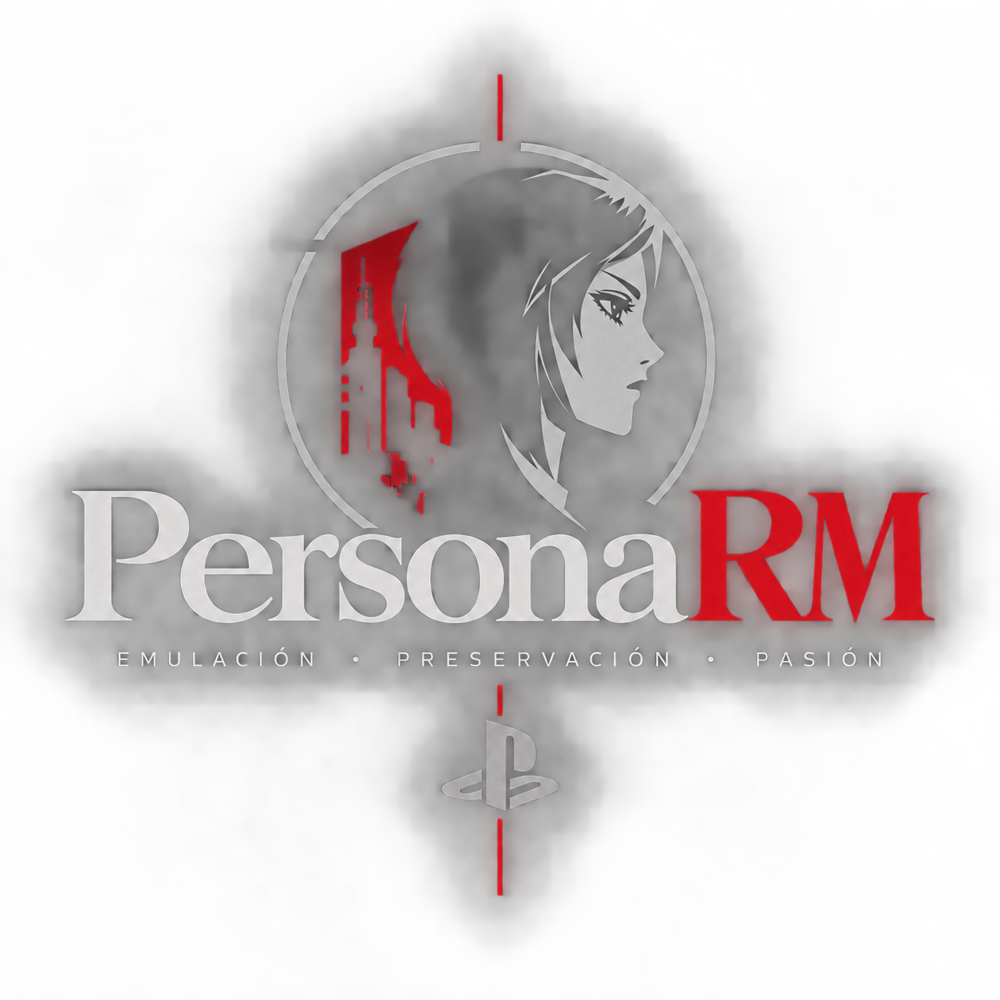

<div align="center">



# PersonaRM

**A native PC runtime and launcher for *Persona 2: Eternal Punishment* (PlayStation 1)**

[](./LICENSE)
[](#building-from-source)
[](#building-from-source)
[](https://github.com/sargon494/PersonaRM/actions)
[](https://sargon494.github.io/PersonaRM/)

[Website](https://sargon494.github.io/PersonaRM/) · [Status](#status) · [Roadmap](#roadmap) · [Quick start](#quick-start) · [Building](#building-from-source) · [Documentation](#documentation) · [Contributing](#contributing)

</div>

---

## Overview

PersonaRM aims to run *Persona 2: Eternal Punishment* natively on Windows and Linux, without an external emulator. It rebuilds the PlayStation 1 hardware the game depends on (MIPS R3000A CPU, GTE, GPU, MDEC, SPU, CD-ROM) and wraps it in a launcher that manages your disc images, controls, and display options.

> **Not playable yet.** PersonaRM is a research-driven work in progress. In a headless test harness, the game's real executable already plays its intro videos with sound, shows the title screen, and on a new game reaches the first 3D scenes with dialogue. There is no game window yet, and the boot has not been checked against a reference emulator. See [Status](#status) for what exists today.
>
> **Current phase: step 3 of 6, first boot.** Steps 1 (CPU correctness) and 2 (machine core) are done. `personarm --boot` runs disc 1 through the intro FMVs, the title screen and a new game up to the first in-game dialogue, with frames and audio dumped to files. Next: confirm the boot against a reference emulator trace, then player control in the field.

PersonaRM follows a strict **Bring Your Own Copy (BYOC)** model:

- **No game content is distributed.** The repository contains no game binaries, ROMs, or assets.
- **You supply your own disc.** Provide an image (`.cue`/`.bin`, `.iso`, or `.img`) from a copy you own.
- **Planned enhancements.** Widescreen viewports, controller glyphs for PlayStation, Xbox, and Nintendo layouts, turbo speed up to 16×, and quicksave.

New to the codebase? Start with the [Developer Guide](docs/DEVELOPER_GUIDE.md) and the [Architecture overview](ARCHITECTURE.md).

## What we know about the game

Verified by reading the Japanese release's discs and executable (nothing here is copied from the game):

- The main game is one disc. The Japanese *Deluxe Pack* adds a separate **Sumaru TV Special Preview Disc**, which boots on its own with its own executable and is not a second story disc.
- Both discs use the standard `PS-X EXE` format and share one engine, built with the Sony PsyQ libraries.
- Game data lives in numbered `F*.BIN` / `F*.EXT` containers indexed by a position table on the disc. Many containers are RLE-compressed. Videos are 320×240 STR streams with XA audio.
- The game calls both BIOS routines and PlayStation hardware registers directly, so a faithful runtime needs both a BIOS layer and real hardware behaviour.
- Large parts of the game code are **overlays**: raw MIPS code loaded from the disc into fixed memory slots on demand. This shapes the design below.

## Roadmap

The chosen approach is an **interpreter-first native runtime**, with static recompilation added on top once the interpreter can be checked against a reference emulator:

1. ✅ **CPU correctness.** A conformance test suite for every MIPS-I instruction, including delay slots, load delays, unaligned access, overflow traps, exceptions, and edge cases of `DIV`.
2. ✅ **Complete machine core.** Interrupt controller, DMA, timers, CD-ROM, joypad bus, and a real GPU rasterizer.
3. 🔨 **First boot.** Run the game's main executable up to the first overlay load, and compare against a reference trace.
4. **Static recompilation.** Translate the main executable and each overlay ahead of time, with the interpreter as fallback.
5. **Replace library routines** (video playback, pad, memory card, CD, SPU, GPU) with hand-written native code.
6. **Host layer.** SDL3 window and input, OpenGL display, host audio, then the launcher and modern enhancements.

A JIT is not planned: the PS1 workload does not call for one.

## Status

| Subsystem | Status |
|---|---|
| Disc reading (ISO 9660 and raw 2352-byte images, `.cue` resolution) | ✅ Implemented |
| `PS-X EXE` loader | ✅ Implemented (ELF is not supported) |
| MIPS-I CPU interpreter | ✅ Instructions, delay slots, exceptions and interrupts pass a 199-check conformance suite |
| Static analysis tools (`psx_analyze`: FILEPOS, file extraction, chunks, RLE, hazard scan, control-flow graph) | ✅ Implemented |
| GTE (geometry engine) | ✅ All 22 commands, FLAG and UNR division (not yet checked against real-hardware results) |
| GPU and VRAM | ✅ Software rasterizer: polygons, lines, sprites, textures with CLUT, semi-transparency, GPUREAD |
| MDEC video and XA audio | ✅ Wired in; the game's FMVs decode with sound (timing values approximated) |
| SPU audio | 🟡 Registers, ADPCM, pitch, ADSR and reverb, wired into the bus; the interpolation table is an approximation |
| BIOS HLE | ✅ Kernel events, interrupt chain, patchable tables and file calls the game uses (memory card still missing) |
| Interrupts, VBlank, root counters | ✅ Implemented (timing approximated) |
| DMA, CD-ROM | ✅ Wired into the bus; the game reads FILEPOS and its first overlay through them (timing approximated) |
| Real-game boot (`personarm --boot`) | 🔨 Disc 1: intro FMVs, title screen, new game and first 3D scenes with dialogue (scripted input, frames/audio dumped to files) |
| Trace format for reference comparison (`PRMTRACE v1`) | ✅ Format, comparator and `--trace-out` |
| Static recompiler (code generation) | ⏳ Not started |
| Windowed SDL / OpenGL display and host audio | ⏳ Stubs only |
| Launcher | 🟡 Disc scan and verification; launching the game is a stub |

## Quick start

> **Note:** There is no playable build. The commands below manage disc images and configuration for development.

**Requirements**

- A legally obtained copy of *Persona 2: Eternal Punishment*.
- Windows 10/11 or a modern Linux distribution.

**Usage**

```bash
# Find disc images in a folder
personarm --scan "/path/to/your/discs"

# Check that a disc image is recognized
personarm --verify-disc "/path/to/disc1.cue"

# Open the interactive Portal (game hub and configuration)
personarm --portal

# Show every option
personarm --help
```

Settings are stored in `personarm_config.json`.

## Building from source

### Prerequisites

- CMake 3.20 or newer
- Ninja, or a standard Make toolchain
- Python 3 (for integration tests)
- A C++17 compiler:
  - **Windows:** Visual Studio 2022 Build Tools (MSVC) or Clang
  - **Linux:** GCC 9 or newer, or Clang

### Windows (MSVC)

Open a *Developer PowerShell for VS 2022* and run:

```powershell
cmake -S . -B build -G Ninja -DCMAKE_BUILD_TYPE=Release
cmake --build build
```

### Linux (GCC or Clang)

```bash
cmake -S . -B build -DCMAKE_BUILD_TYPE=Release
cmake --build build -j$(nproc)
```

## Testing

Tests are off by default. Enable them at configure time and run them with CTest:

```bash
cmake -S . -B build -DBUILD_TESTS=ON -DCMAKE_BUILD_TYPE=Debug
cmake --build build
ctest --test-dir build -C Debug --output-on-failure
```

There is also a cross-platform integration runner: `python tests/integration/run_tests.py`. Note that it rewrites `personarm_config.json`; restore the file afterwards.

Tests that need a real disc are not part of CI and are skipped when no disc is available.

## Architecture

```
┌──────────────────────────────────────────────────────────────┐
│  Launcher & Portal                                           │
│  Display · Controls · Disc manager                           │
└──────────────────────────────┬───────────────────────────────┘
                               ▼
┌──────────────────────────────────────────────────────────────┐
│  Engine (central coordinator)                                │
│  Memory bus: KUSEG / KSEG0 / KSEG1 address translation       │
├──────────┬────────────┬────────────┬────────────┬────────────┤
│ Main RAM │ Scratchpad │  GPU+VRAM  │    SPU     │ Joypad/MC  │
│  2 MB    │   1 KB     │   1 MB     │ 24 voices  │ SPI 0x1F80 │
└──────────┴────────────┴────────────┴────────────┴────────────┘
```

This is the current layout. The planned target separates the PS1 machine core from the host platform and removes global singletons. Hardware details and bus routing are in [ARCHITECTURE.md](ARCHITECTURE.md).

## Documentation

| Document | Contents |
|---|---|
| [Architecture](ARCHITECTURE.md) | Hardware model, memory bus, and execution pipeline |
| [Developer Guide](docs/DEVELOPER_GUIDE.md) | Codebase walkthrough and workflow |
| [Gameplay and Controls](docs/GAMEPLAY_AND_CONTROLS.md) | Controller mapping and in-game options (planned behaviour) |
| [Project Audit](docs/PROJECT_AUDIT.md) | Technical audit and known issues |
| [Contributing](CONTRIBUTING.md) | Bug reports, feature requests, and pull request rules |

## Contributing

Contributions are welcome. Please read [CONTRIBUTING.md](CONTRIBUTING.md) and the [Developer Guide](docs/DEVELOPER_GUIDE.md) before opening a pull request. Bug reports and feature requests go in the issue tracker.

## Legal notice

PersonaRM is an independent, unofficial project. It is not affiliated with, endorsed by, or sponsored by Atlus, Sega, or Sony Interactive Entertainment. The project does not distribute game discs, binaries, ROMs, or assets; users must supply their own legally obtained copy. All trademarks belong to their respective owners.

## License

PersonaRM is licensed under the **GNU General Public License v3.0 or later**. See [LICENSE](./LICENSE).
